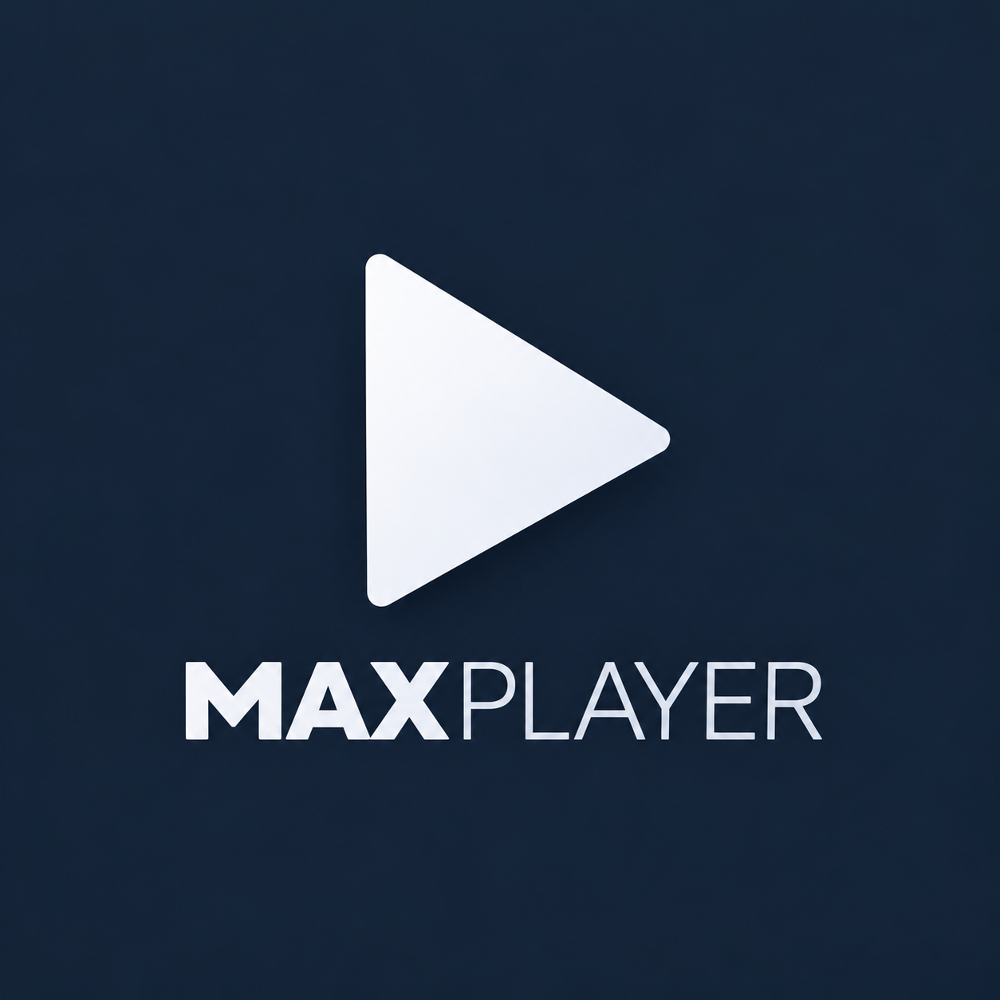
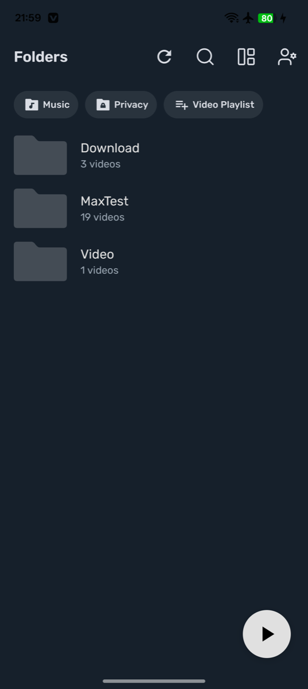
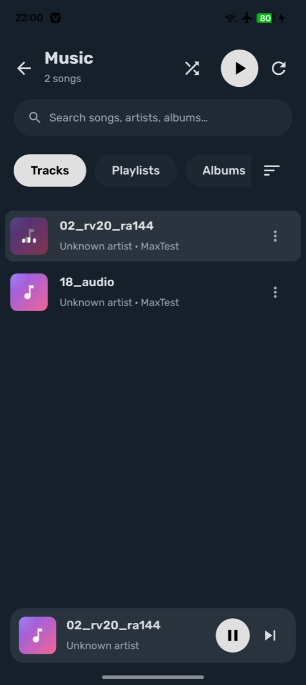
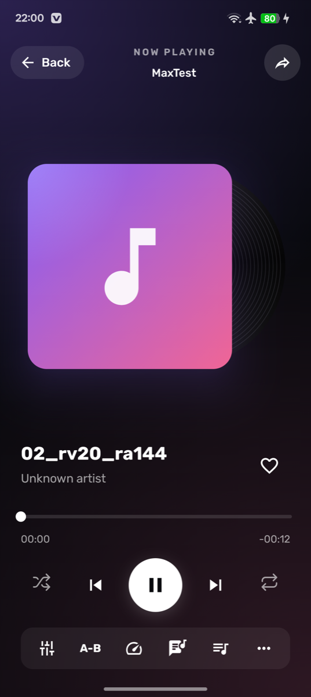
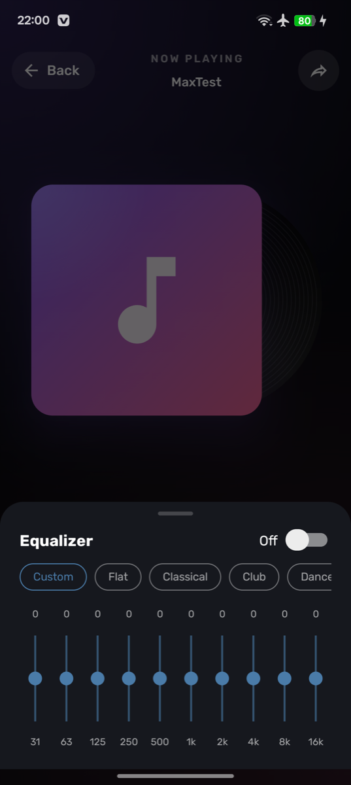
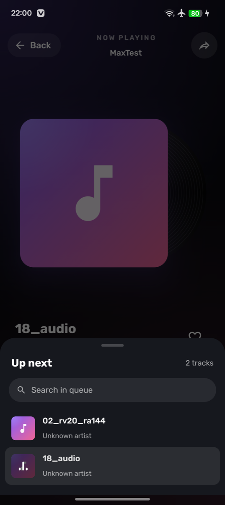
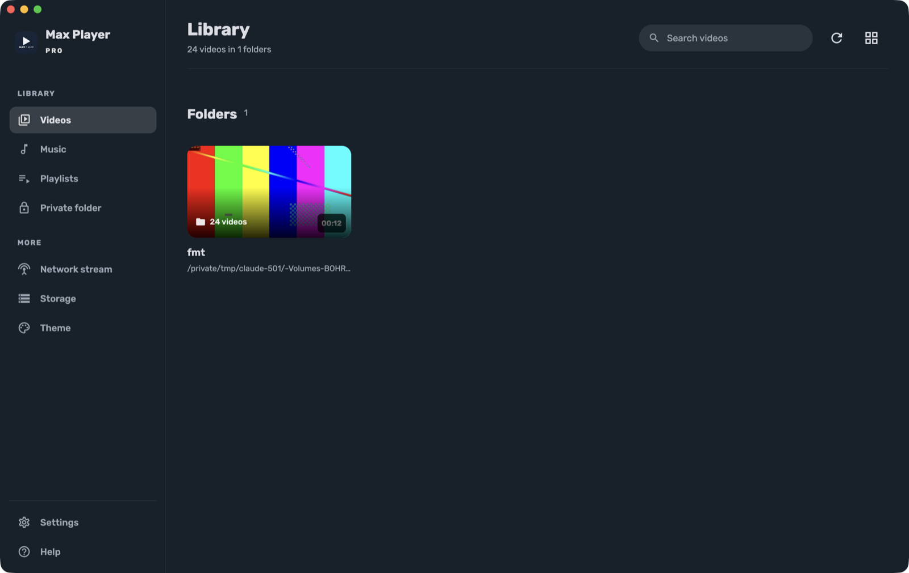
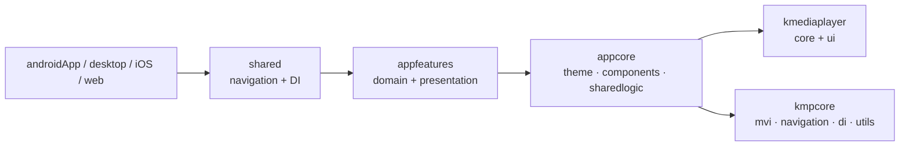

<div align="center">



# Max Player

**A fast, gesture-driven video and music player built with Kotlin Multiplatform and Compose.**


</div>

---

## ✨ Features

| | |
|---|---|
| 🎬 **Video player** | Swipe to seek, brightness and volume gestures, pinch zoom, double-tap skip, long-press fast-forward |
| 🎵 **Music player** | Tracks, albums, artists, folders and playlists, mini player, Now Playing, background playback |
| 📝 **Subtitles** | Embedded tracks, auto-loaded `.srt` / `.vtt`, sync and speed, fully styled text |
| 🎚️ **Audio** | Equalizer with presets, bass boost, reverb, volume boost to 200% |
| ⏱️ **Playback tools** | Speed 0.25×–4×, A-B repeat, sleep timer, bookmarks, resume where you stopped |
| 🖼️ **Display** | Zoom modes, aspect ratios, picture-in-picture, night mode, lock and kids lock |
| 🔒 **Private Folder** | PIN-protected storage hidden from other apps |
| 📂 **Library** | Folder and file views, sorting, grid / list, NEW and SUB tags, search, media manager |
| 🎨 **Themes** | Dark, light, AMOLED black or adaptive, with 19 accent colours |

## 📸 Screenshots

### Mobile

| Home | Music | Now Playing | Equalizer | Up next |
|:---:|:---:|:---:|:---:|:---:|
|  |  |  |  |  |

### Desktop



## 🏗️ Architecture

Max Player is split into small Gradle modules. Every screen is its own feature with a **domain** module (MVI contract, ViewModel, Koin wiring — no Compose) and a **presentation** module (Compose UI only).

```text
MaxPlayer/
├── androidApp/  iosApp/  desktopApp/  webApp/    platform entry points
├── shared/                 app root: navigation graph + Koin modules
│
├── kmpcore/                ⟶ submodule: MVI, navigation, DI, utils, storage
├── kmediaplayer/           ⟶ submodule: reusable media player library
│   ├── core/               engine (Media3), background service, settings, PlayerHost
│   └── ui/                 video player, panels, mini player, Now Playing
│
├── appcore/                theme, colour tokens, shared components
│   ├── appres/             icons, fonts, logo
│   └── sharedlogic/        media library, user data, private folder, file actions
│
└── appfeatures/            one module per screen → domain + presentation
    ├── home        ├── folder       ├── search      ├── music
    ├── player      ├── settings     ├── profile     ├── theme
    ├── playlists   ├── privatefolder├── mediamanager├── help
    └── localnetwork
```



**Flow of a screen:** the Compose `Screen` collects `State` from its `ViewModel` and sends `Event`s; the ViewModel reads repositories from `sharedlogic` and emits one-off `Effect`s. The player library knows nothing about Max Player — the app plugs in through `PlayerHost`.

## 🚀 Getting started

```bash
git clone --recurse-submodules https://github.com/sylar-apex/MaxPlayer.git
cd MaxPlayer
```

Already cloned without submodules?

```bash
git submodule update --init --recursive
```

| Target | Command |
|---|---|
| Android | `./gradlew :androidApp:assembleDebug` |
| Desktop | `./gradlew :desktopApp:run` |
| Web (Wasm) | `./gradlew :webApp:wasmJsBrowserDevelopmentRun` |
| iOS | open `iosApp/` in Xcode and run |

> Building next to an existing install signed with another key? Add `-PdevInstall` to install as `org.app.maxplayerpro.dev`.

## 📱 Platform status

| Platform | Library & UI | Playback |
|---|---|---|
| Android | ✅ full | ✅ Media3 ExoPlayer |
| Desktop | ✅ | 🚧 engine planned |
| iOS | ✅ | 🚧 AVPlayer engine planned |
| Web | ✅ | 🚧 HTML video engine planned |

## 🧩 Built with

[Kotlin Multiplatform](https://kotlinlang.org/docs/multiplatform.html) ·
[Compose Multiplatform](https://www.jetbrains.com/compose-multiplatform/) ·
[Media3 ExoPlayer](https://developer.android.com/media/media3) ·
[Koin](https://insert-koin.io) ·
[Navigation Compose](https://www.jetbrains.com/help/kotlin-multiplatform-dev/compose-navigation.html) ·
[kmpcore](https://github.com/sylar-apex/kmpcore) ·
[KMediaPlayer](https://github.com/sylar-apex/kmediaplayer)

---

<div align="center">Made with ❤️ by <a href="https://github.com/sylar-apex">sylar-apex</a></div>
